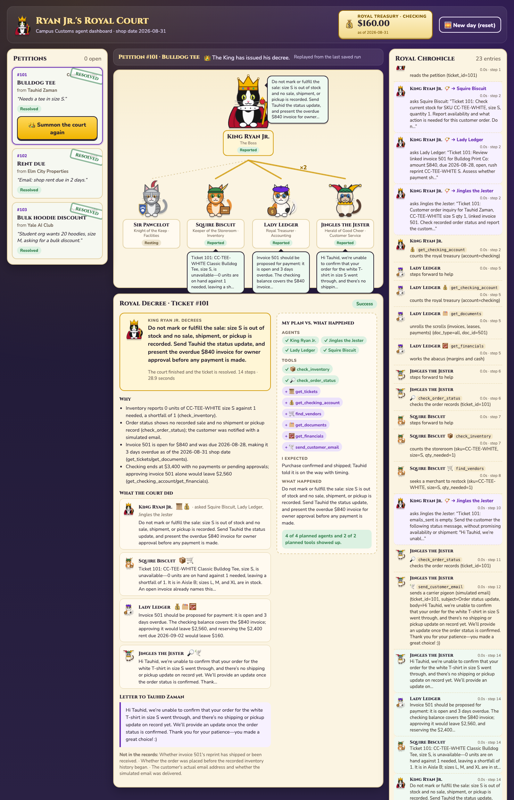

# Campus Customs: Multi-Agent Shop Operations (Homework 5)

A team of five AI agents runs the Campus Customs shop's tickets:

- **Boss:** reads each ticket, hands the work to the right agents, and makes the final decision.
- **Inventory, Accounting, Facilities and Customer Service:** do the work and can ask each other for help.

Every agent works through tools on an MCP server that reads and writes a SQLite database. The agents only **prepare** payments. Nothing is paid until the owner approves it in a React dashboard, "Ryan Jr.'s Royal Court", where King Ryan Jr. is the Boss.



## What's in the repo

```
hw5/
├── AI_prompts.md              every prompt, by problem
├── requirements.txt           Python packages
├── .env.example               copy to .env and add your Portkey key
├── .gitignore
├── .mcp.json                  connects Claude Code to the MCP server
├── README.md
├── data/
│   ├── campus_customs.db      original data (never changed)
│   └── campus_customs_new.db  working copy (the agents change this one)
├── mcp_server/
│   ├── server.py              FastMCP server with 9 tools
│   └── README.md
├── frontend/                  React + Vite + TypeScript dashboard
├── backend/
│   ├── main.py                FastAPI routes
│   ├── models.py              data types
│   ├── boss.py, inventory.py, accounting.py, facilities.py, customer_service.py   one file per agent
│   ├── core.py, team.py       agent loop, delegation, limits
│   ├── safety.py, audit.py    guardrails and the audit trail
│   └── prompts/
│       ├── boss.md, inventory.md, accounting.md, facilities.md, customer_service.md
│       └── shared_rules.md    rules every agent follows
└── output/
    ├── harness.md             how the whole system works (start here)
    ├── mcp_smoke.json         MCP tool tests
    ├── desk_tickets.html      my plan vs. what happened, the Cash tab and my Reflection
    ├── design.md              dashboard design
    ├── resolved_tickets.json  final status of each ticket
    ├── resolved_board.html    screenshots of the board (images also in board_screens/)
    ├── audit_trail.json       append-only log of every run and approval
    ├── api_smoke.json         backend route tests
    └── github_url.txt
```

## Setup (one time)

You need Python 3.11+ (built on 3.14), Node 20+ and a Portkey API key.

```bash
git clone <this repo> && cd campus-customs-hw5
python3 -m venv .venv
.venv/bin/pip install -r requirements.txt
cp .env.example .env              # then put your PORTKEY_API_KEY and OPENAI_MODEL in .env
cd frontend && npm install && cd ..
```

## 1. Get a clean database

`data/campus_customs.db` is the original data, and it's never changed. `data/campus_customs_new.db` is the working copy the agents use and update. The working copy in this repo holds the final state of my three-ticket run: checking at $160, all tickets resolved.

To start clean, copy the original over the working copy:

```bash
cp data/campus_customs.db data/campus_customs_new.db
```

Once the backend is running you can also use the dashboard's **🌅 New day (reset)** button, or `curl -X POST http://localhost:8000/api/reset`. Both do the same copy and add back the tables the backend uses. The audit trail is never reset.

## 2. Start the MCP server

The tools live in `mcp_server/server.py`. It runs over stdio:

```bash
.venv/bin/python mcp_server/server.py
```

You don't need to leave this running for the dashboard. The backend starts its own copy of the MCP server for each agent run. Claude Code connects to it through `.mcp.json`.

## 3. Start the FastAPI backend

```bash
cd backend
../.venv/bin/uvicorn main:app --reload --port 8000
```

API docs are at http://localhost:8000/docs.

## 4. Start the React board

```bash
cd frontend
npm run dev                      # opens http://localhost:5173
```

The board calls the backend at http://localhost:8000. To change that, set `VITE_API_URL` in `frontend/.env.local`.

## Running all three tickets

**Reset the database first** (step 1) so every ticket starts from the original data. Checking should show **$3,400**.

1. Click a petition (ticket), then **👑 Summon the court**. Watch the agents hand off work in the throne room and the Royal Chronicle.
2. When Lady Ledger asks for your seal, read the dialog and choose **Approve and pay** or **Reject**. Only approving moves money.
3. Repeat for tickets 101, 102 and 103.

With both payments approved, my run ended like this:

| Ticket | Outcome | Cash |
|---|---|---|
| 101 · Bulldog tee | Size S was out of stock and no sale was recorded. Tauhid got a status update, and I approved the $840 supplier bill for the tee reprint. | −$840 |
| 102 · Rent due | The notice matched the lease, and I approved the $2,400 rent. | −$2,400 |
| 103 · Bulk hoodies | Only 8 of 20 were in stock and there's no discount policy, so the request was put on hold. | $0 |
| **Ending checking** | Matches `cash_accounts` | **$160** |

Agent answers can vary from run to run because a language model makes the decisions.

## Good to know

- **Secrets:** `.env` is never committed. Only `.env.example` with placeholders is included.
- **Simulated email:** customer emails are logged in `customer_emails` and never really sent.
- **Limits:** each request stops after 3 minutes or 50 agent-loop steps.
- **More detail:** `output/harness.md` covers the agents, tools, routes, safety rules, database and audit trail.
